# Bitácora técnica - TP02 Robot Unitree Go2

**Alumnos:** Santiago Balsamo, Emanuel Brandt, Martin Salvagni, Lihuen Flores
**Materia:** Programación I
**Repositorio:** (https://github.com/lihuenflores0/UadeRobotLab)

## Registro de acciones

| Nº | Acción / comando | Resultado | Problema | Solución intentada | Estado |
|---|---|---|---|---|---|
| 1 | Clone del repositorio UadeRobotLab | Repo clonado | - | - | RESUELTO |
| 2 | Fork en GitHub | Fork creado | - | - | RESUELTO |
| 3 | Lectura de INSTALACION.md y LEEME_ESTUDIANTE.md | Respondidas preguntas a-e | - | - | RESUELTO |
| 4 | `systeminfo \| findstr /B /C:"OS Name" /C:"OS Version"` | Windows 11 Home, 10.0.26200 Build 26200 | - | - | RESUELTO |
| 5 | `echo %PROCESSOR_ARCHITECTURE%` | AMD64 | - | - | RESUELTO |
| 6 | `py -3 --version` / `python --version` | Python 3.14.8 | - | - | RESUELTO |
| 7 | `py -3 -m pip --version` | pip 26.3 | - | - | RESUELTO |
| 8 | `git --version` | git 2.53.0.windows.2 | - | - | RESUELTO |
| 9 | `python3 -c "import mujoco; print(mujoco.__version__)"` | 3.14.0 | - | MuJoCo ya estaba instalado, no hizo falta pip install | RESUELTO |
| 10 | `py -3 -m pip install mujoco` |	`Requirement already satisfied: mujoco 3.14.0 (y dependencias)` | - | Ya estaba instalado | RESUELTO |
| 11 | INICIAR_SIMULADOR.bat, opción 1 (G1) | Simulador iniciado: Robot: Unitree G1 | - | - | RESUELTO |
| 12 | py -3 mi_desarrollo\mi_tp02.py desde la terminal de VS Code, con el simulador G1 abierto (plantilla sin completar) | [OK] Conectado a Unitree G1, límites 0.2 m/s / 0.5 rad/s / 10 s, [OK] Desconectado | - | - | RESUELTO |
| 13 | `ejecutar_mision(robot, MISION_BASICA, historial)` (simulador G1 abierto) | 4 ejecutados, 0 rechazados; el robot avanzó, giró a la derecha y avanzó | - | - | RESUELTO |
| 14 | `MISION_CON_ERRORES` en `main()` | 11 recibidos: 4 ejecutados, 7 rechazados. La misión no se cortó y el reporte final se generó | - | - | RESUELTO |
| 15 | `MISION_CUADRADO` en `main()` | 9 recibidos: 9 ejecutados, 0 rechazados. (Completar: si el robot volvió cerca del punto de partida) | - | - | RESUELTO |
| 16 | Agrego `MISION_CIRCULO` (polígono de 24 lados) a `misiones.py` y `py -3 mi_desarrollo\mi_tp02.py` con esa misión en `main()` | 49 recibidos: 49 ejecutados, 0 rechazados. (Completar: si el círculo cerró o quedó abierto) | - | - | RESUELTO |

## Respuestas de la sección 3

### a) ¿Qué herramientas necesita el TP?

- **Python 3.10 o superior:** ejecuta todo, el simulador y mi programa.
- **MuJoCo** (`pip install mujoco`): es la ventana 3D donde se ve el robot.
- **Visual C++ Redistributable (x64):** solo en Windows; sin él, MuJoCo se instala pero no carga.
- **Modelos del G1 y del Go2:** el robot que se ve en pantalla. Ya vienen dentro del paquete (`entorno/sim/unitree_mujoco/`, unos 46 MB).
- **Carpeta del laboratorio:** el TP en sí (`05LaboratoriosTPs/TP02_Programacion_I/`).

### b) ¿Qué versión de Python se requiere?

Python 3.10 o superior. El ejemplo de verificación de la guía muestra Python 3.12.3, así que versiones más nuevas también funcionan.

### c) ¿Qué componentes ya están instalados en la computadora?

En la computadora ya estaba instalado Python 3.14, Git 2.53, Visual Studio Code y MuJoCo (el import devuelve la versión 3.14.0).

### d) ¿Qué componentes del repositorio oficial de Unitree no son necesarios?

Para este laboratorio no hacen falta:

- **CycloneDDS:** solo publica paquetes precompilados hasta Python 3.10, y con versiones más nuevas pip intenta compilarlo y falla con "Could not locate cyclonedds".
- **unitree_sdk2_python (el SDK oficial):** llama a `timerfd_create`, que existe solo en Linux, por lo que en macOS y Windows el import falla con "symbol not found".
- **Compilar nada ni clonar el repo completo de Unitree:** los modelos del G1 y del Go2 ya vienen recortados dentro del paquete (el repo completo pesa 299 MB; el paquete trae unos 46 MB).

### e) Diferencias entre el TP en PDF y el repositorio actual

El PDF usaba un simulador que solo imprimía logs y comandos expresados como objetivos (distancia y velocidad; ángulo en grados y sentido en texto). El repositorio actual usa un gemelo digital en MuJoCo y expresa todo en velocidad y tiempo, donde el signo de la velocidad angular indica el sentido. Los límites cambian a 0.20 m/s, 0.50 rad/s y 10 s, y ahora también se evalúa la instalación y la bitácora.

| Aspecto | TP en PDF | Repositorio actual |
|---|---|---|
| Simulador | `unitree_sdk_sim.py` (solo logs) | `robot.py` + MuJoCo por socket local |
| avanzar | `("avanzar", distancia, velocidad)` | `("avanzar", velocidad, tiempo)` |
| girar | `("girar", 90, "derecha")` (grados y texto) | `("girar", -0.5, 3.14)` (rad/s y segundos; el signo da el sentido) |
| Límites | 0.5 m/s, 5 m, 180° | 0.20 m/s, 0.50 rad/s, 10 s |
| Funciones | `inicializar_robot`, `procesar_comando` | `comando_es_valido`, `ejecutar_comando` |
| Control de seguridad | Solo la validación propia | Además, el robot lanza `ErrorDeSeguridad` |
| Instalación | Solo Python | Python + MuJoCo + Visual C++ en Windows |

## Etapa 1: caracterización del entorno

| Elemento | Información obtenida |
|---|---|
| Sistema operativo | Microsoft Windows 11 Home |
| Versión del sistema operativo | 10.0.26200 N/A Build 26200 |
| Arquitectura | AMD64 |
| Python instalado | Python 3.14.8 |
| Versión de Python | Python 3.14.8 |
| pip disponible | pip 26.3 |
| Git disponible | git version 2.53.0.windows.2 |
| MuJoCo previamente instalado | Sí (versión 3.14.0) |
| IDE utilizado | Visual Studio Code |
| Observaciones | El entorno ya estaba instalado previamente a documentar este punto |

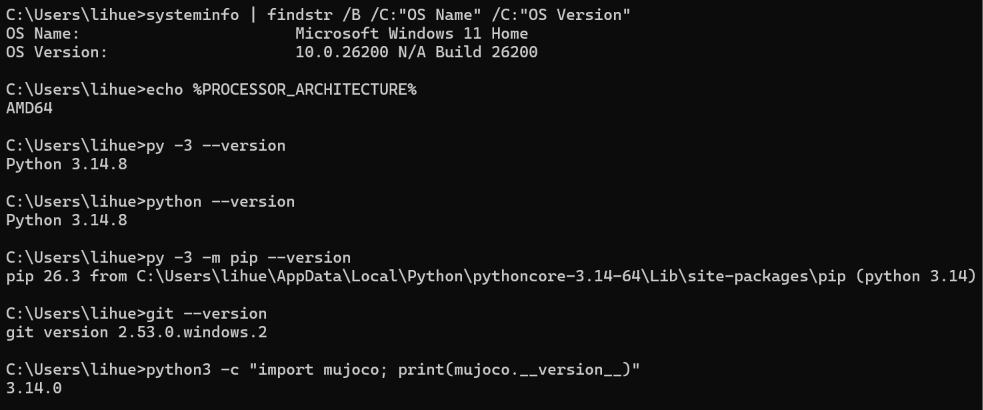

## Etapa 2: obtención del repositorio

**Método:** clonación con GitHub Desktop desde
https://github.com/tsamaan/UadeRobotLab.git.
**Ruta local:** C:\Users\lihue\OneDrive\Escritorio\GitHub\-Proyecto-Integrador--Etapa-1--Consejo-del-Mate\UadeRobotLab
**Fork:** https://github.com/lihuenflores0/UadeRobotLab

Los archivos `INSTALACION.md` y `LEEME_ESTUDIANTE.md` se encuentran
en `05LaboratoriosTPs/TP02_Programacion_I/`.

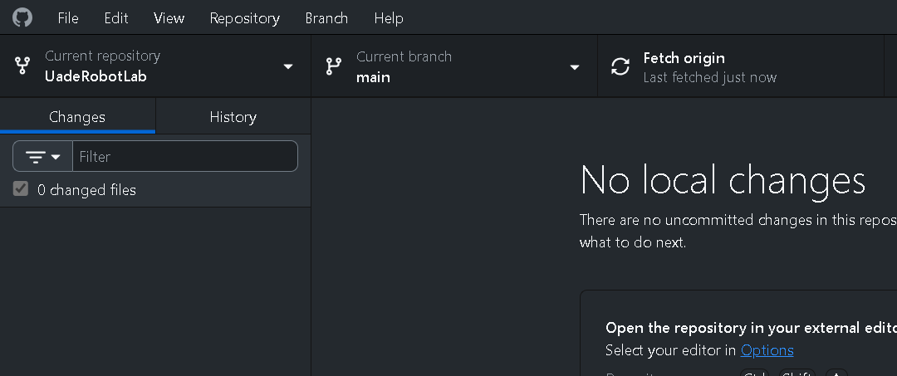

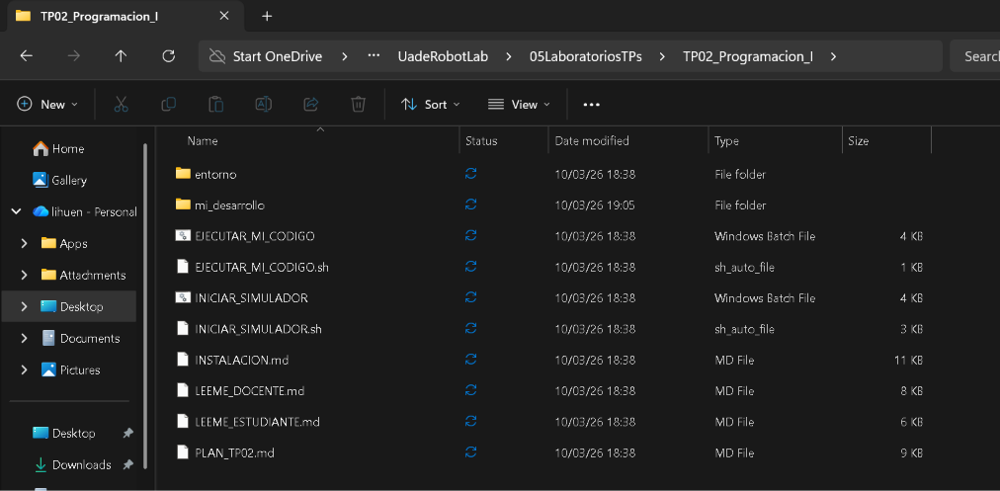

## Etapa 3: instalación de MuJoCo

**Comando:** `py -3 -m pip install mujoco`
**Salida:** Requirement already satisfied: mujoco in C:\Users\lihue\AppData\Roaming\Python\Python314\site-packages (3.14.0), junto con sus dependencias (numpy, glfw, pyopengl, etc.).
**Versión instalada:** 3.14.0 (confirmada con `import mujoco`).
**Advertencias / errores:** ninguno. No hubo errores de certificados.
**Solución aplicada:** ninguna, MuJoCo ya estaba instalado.

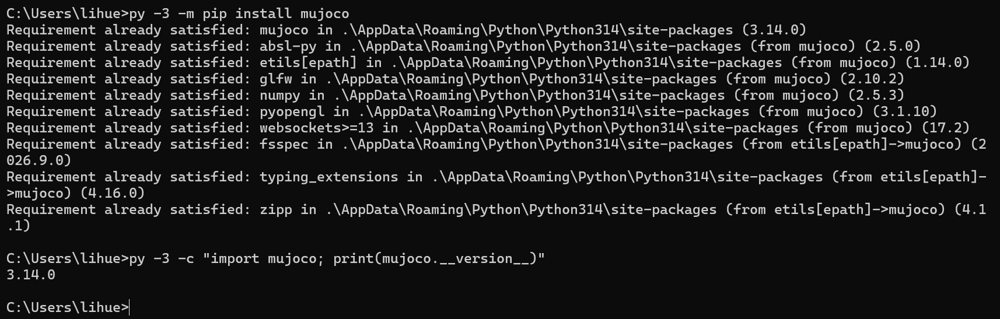

## Etapa 4: verificación del entorno

**Comando:** `py -3 -m sim --solo-revisar` (ejecutado desde `05LaboratoriosTPs/TP02_Programacion_I/entorno`)
**Resultado:** [OK] Python 3.14.8, [OK] MuJoCo v3.14.0, [OK] Modelos oficiales de Unitree. Mensaje final: "Todo listo."
**Problemas:** ninguno.

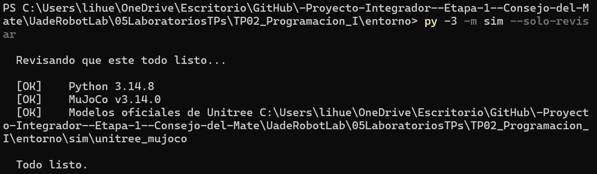

## Etapa 5: puesta en marcha del gemelo digital

**Comando:** `INICIAR_SIMULADOR.bat`, robot seleccionado: 1 (G1)
**Aclaración:** el orientador menciona el Go2, pero se trabaja con el G1
**Resultado:** el simulador inició correctamente (Python 3.14.8, MuJoCo v3.14.0). Se abrió la ventana de MuJoCo con el G1 visible.
**Problemas:** ninguno.

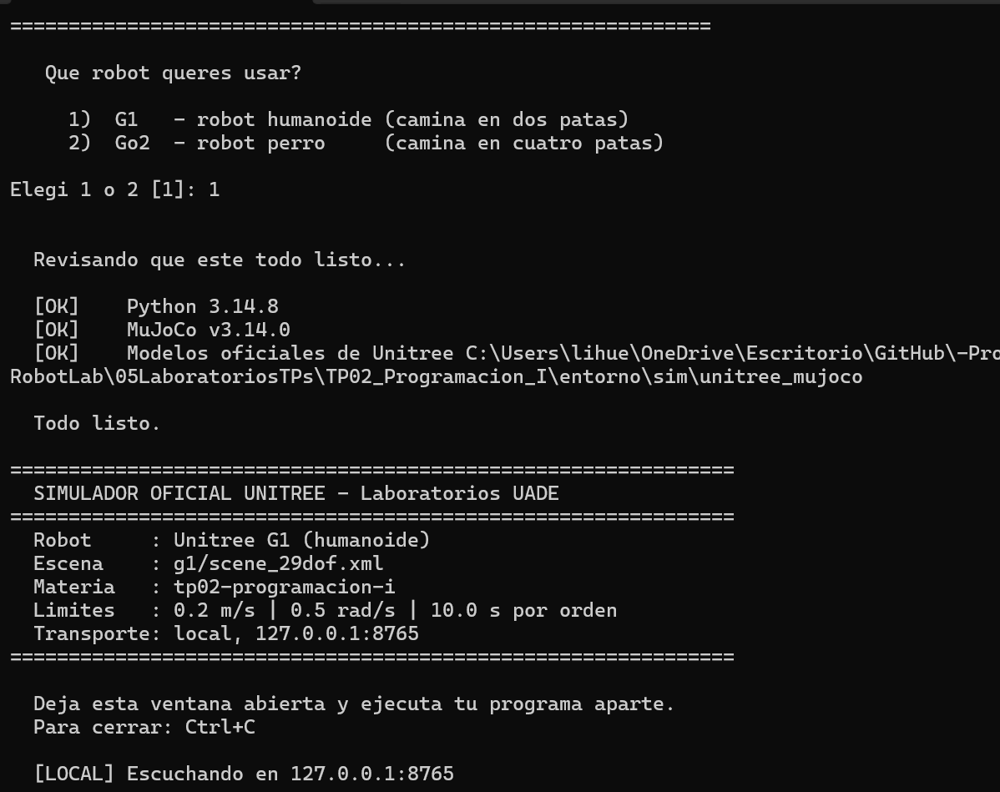

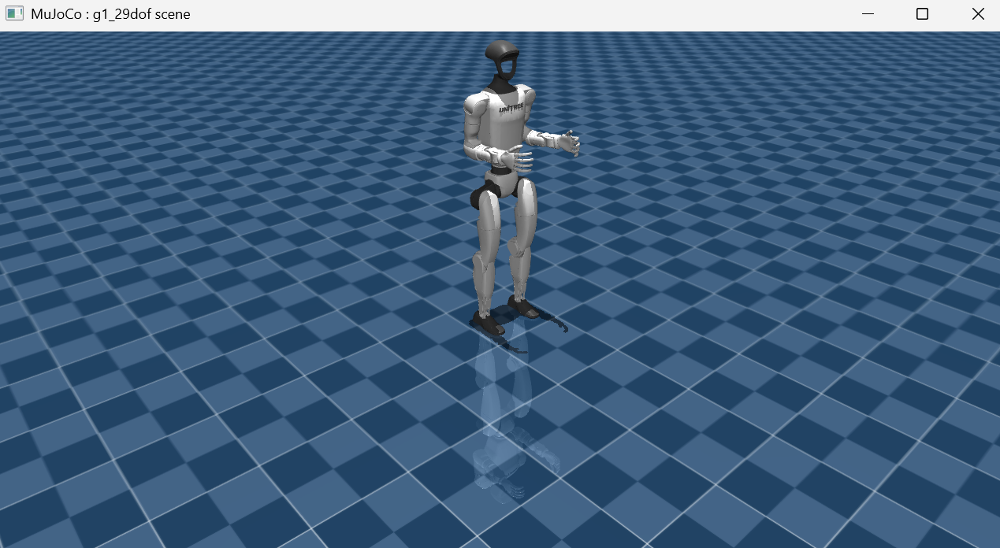

## Arquitectura del laboratorio (sección 12)

Nuestro programa no mueve el robot directamente. Pasa por tres partes:

```
mi_tp02.py
 |
 | robot.avanzar(...) / robot.girar(...) / robot.detenerse()
 v
robot.py (puente: no se modifica)
 |
 | socket local 127.0.0.1
 v
Gemelo digital: MuJoCo + modelo Unitree
```

- **`mi_tp02.py`**: es nuestro programa. Revisa los comandos de la misión y decide cuáles se mandan al robot. Solo se ocupa de la lógica.
- **`robot.py`**: es el puente. Recibe las órdenes de nuestro programa y se las pasa al simulador. También controla los límites de seguridad: si una orden es demasiado fuerte o larga, la rechaza con un error (`ErrorDeSeguridad`). No se modifica.
- **Socket local (127.0.0.1)**: es el "cable" entre `robot.py` y el simulador. Es local porque los dos programas corren en la misma computadora, pero son programas separados.
- **Gemelo digital (MuJoCo)**: es la ventana 3D con el robot. Recibe las órdenes y mueve el modelo.

**Por qué hay que abrir el simulador primero:** `robot.py` se conecta al simulador por el socket. Si el simulador no está abierto, no hay nadie del otro lado y la conexión falla.

**Por qué es útil esta arquitectura:** podemos probar nuestras misiones en una simulación, sin un robot real y sin instalar el SDK oficial de Unitree.


## Etapa 6: primer programa contra el gemelo digital

**Comando:** `py -3 mi_desarrollo\mi_tp02.py` (terminal de VS Code, simulador G1 abierto en otra terminal)
**Estado del código:** plantilla sin completar (las cuatro funciones con `# TU CODIGO ACA`).
**Conexión:** exitosa. `[OK] Conectado a Unitree G1 (humanoide).` 
**Movimiento observado:** ninguno, porque `ejecutar_mision` todavía no recorre comandos.
**Cierre:** `[OK] Desconectado.`
**Errores:** ninguno.

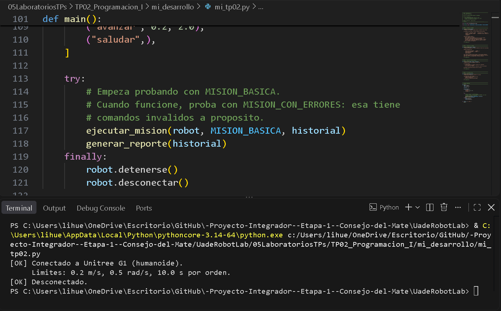

## Etapa 7: pruebas de misiones

### MISION_BASICA

**Comando:** `py -3 mi_desarrollo\mi_tp02.py` con `MISION_BASICA` en `main()`
**Qué se esperaba:** 4 comandos ejecutados, 0 rechazados. El robot avanza 0.4 m, gira 90° a la derecha y avanza 0.4 m.
**Qué se observó:** El robot avanza un paso, gira y avanza un paso mas
**Salida de la terminal - reporte:** 4 recibidos / 4 ejecutados / 0 rechazados
**Errores:** ninguno

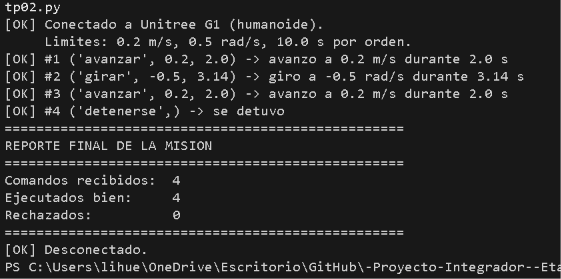

### MISION_CON_ERRORES

| # | Comando | Motivo registrado | Quién lo rechazó |
|---|---|---|---|
| 3 | ("avanzar", 0.9, 2.0) | rechazado por el robot (seguridad) | robot.py |
| 4 | ("avanzar", 0.2, 50.0) | rechazado por el robot (seguridad) | robot.py |
| 5 | ("girar", 3.0, 2.0) | rechazado por el robot (seguridad) | robot.py |
| 6 | ("volar", 0.2, 1.0) | comando desconocido: volar | comando_es_valido |
| 7 | ("avanzar", "rapido", 2.0) | la velocidad no es un numero | comando_es_valido |
| 8 | ("avanzar", 0.2) | avanzar lleva 2 datos | comando_es_valido |
| 9 | ("avanzar", 0.2, -3.0) | el tiempo es negativo | comando_es_valido |

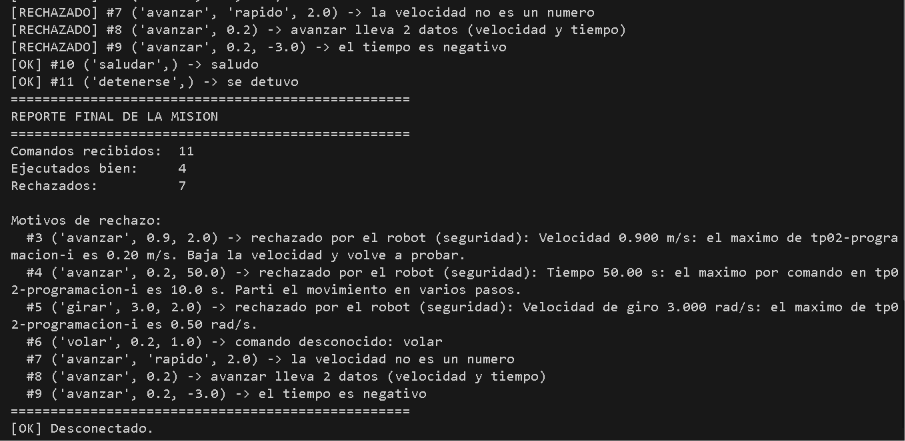

### MISION_CUADRADO

**Comando:** `py -3 mi_desarrollo\mi_tp02.py` con `MISION_CUADRADO` en `main()`
**Qué se esperaba:** 9 comandos ejecutados, 0 rechazados. Cada lado avanza 0.4 m (0.2 m/s × 2 s) y cada giro es de 90° a la derecha (-0.5 rad/s × 3.14 s ≈ -1.57 rad). Con cuatro lados y cuatro giros, el robot debería volver cerca del punto de partida y con el mismo rumbo.
**Qué se observó:** El robot avanza un paso, gira a la derecha, avanza otro paso, gira nuevamente a la derecha avanzando un paso, gira a la derecha, avanza un ultimo paso y por ultimo gira a la derecha volviendo a su posicion inicial.
**Salida de la terminal - reporte:** 9 recibidos / 9 ejecutados / 0 rechazados
**Errores:** ninguno

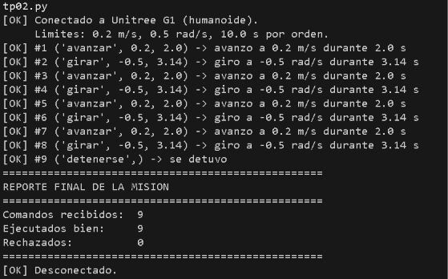

### Misión propia: MISION_CIRCULO

**Objetivo:** hacer que el robot recorra una figura lo más parecida posible a un círculo.
**Diseño:** los comandos `avanzar` y `girar` se ejecutan uno después del otro, no a la vez, por lo que el robot no puede trazar una curva continua. Se aproxima el círculo con un polígono regular de 24 lados: se repite 24 veces el par "avanzar un tramo corto + girar un ángulo chico". Cuantos más lados, más se parece a un círculo.

**Cálculos:**
- Lado: 0.2 m/s × 0.5 s = 0.1 m
- Giro: 0.5 rad/s × 0.5236 s = 0.2618 rad = 15° a la izquierda
- Giro total: 24 × 15° = 360° (vuelve al rumbo inicial)
- Perímetro: 24 × 0.1 m = 2.4 m
- Radio aproximado: 0.1 / (2 × sen(7.5°)) ≈ 0.38 m

**Código:**
MISION_CIRCULO = [
    ("avanzar", 0.2, 0.5),
    ("girar", 0.5, 0.5236),
] * 24 + [("detenerse",)]

**Qué se esperaba:** 49 comandos recibidos (24 × 2 + `detenerse`), 49 ejecutados, 0 rechazados. El robot gira siempre a la izquierda y termina cerca del punto de partida.
**Qué se observó:** El robot avanzo y giro desde el punto de inicio, formando una figura circular hasta volver al mismo punto de partida.
**Salida de la terminal - reporte:** 49 recibidos / 49 ejecutados / 0 rechazados
**Errores:** ninguno

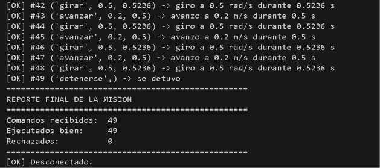
